  

  
  
  

I'm **Antonio**, a software engineer in São Paulo, Brazil. I build web and mobile software, work with healthcare teams, and turn ideas into working applications.

### Currently building

**[KnoVet](https://www.knovet.com)**  
A pet-tech platform I founded to connect pet owners with professionals and local pet businesses. I build the platform, internal tools and automations — from discovery and onboarding to the workflows behind the product.

**[Care Continuity](https://www.carecontinuity.com/)**  
Building software for a US healthcare platform: clinical interfaces, reusable components, backend integrations and test automation. I also develop AI-assisted QA workflows using MCP and custom skills.

### Engineering impact

At **Care Continuity**, my work has included:

- **Reusable UI architecture:** approximately **30% less development effort** for new interface workflows through shared components.
- **Faster production diagnostics:** Sentry integration helped bring issue detection from **hours to minutes**.
- **AI-assisted QA:** workflows that turn natural-language requirements into test scenarios using **MCP and custom engineering skills**.

[More about my experience ↗](https://www.linkedin.com/in/antoniofiglio/details/experience/)

### Technical focus

- **Frontend:** React · JavaScript · TypeScript · Next.js · Vite
- **Backend & data:** Node.js · Fastify · C# / .NET · PostgreSQL · MongoDB
- **Testing & delivery:** Playwright · Vitest · Sentry · Docker · Azure DevOps · Vercel
- **AI-assisted development:** Codex · Claude · MCP · custom skills

### Hackathon podiums

- 🥈 **2nd place — [InovaHC Health Hackathon · HCFMUSP](https://www.linkedin.com/feed/update/urn:li:activity:7525660836481314817/)**
- 🥉 **3rd place — [Devs de Impacto Hackathon](https://www.linkedin.com/feed/update/urn:li:activity:7388732522207215616/)**

### Education & credentials

🎓 **PUCPR** — Interdisciplinar em Negócios · **In progress**  
☁️ **AWS AI Business Strategist** — **Exam preparation**

**Completed course credentials**
- **MongoDB:** [Node.js Developer Path](https://learn.mongodb.com/c/wZgL_jT1Q_StpguTm7ldbw) · [Indexing Design Fundamentals](https://www.credly.com/badges/3e1aeab6-aa36-4d78-8200-7ac6da595329/linked_in_profile) · CRUD Operations in MongoDB
- **SmallTalk2Me:** English Speaking Level Test

[View credentials ↗](https://www.linkedin.com/in/antoniofiglio/details/certifications/)

### Languages

**Portuguese** — Native / bilingual · **English** — Professional working proficiency  
**Spanish** — Full professional proficiency · **Italian** — Elementary

---

  <strong>Let's talk about engineering, healthcare and building useful software.</strong>  
  <a href="https://www.linkedin.com/in/antoniofiglio/">LinkedIn ↗</a> ·
  <a href="mailto:antonio.oficialcontato@gmail.com">Email ↗</a>

